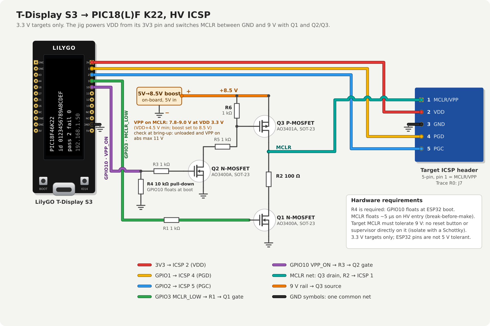
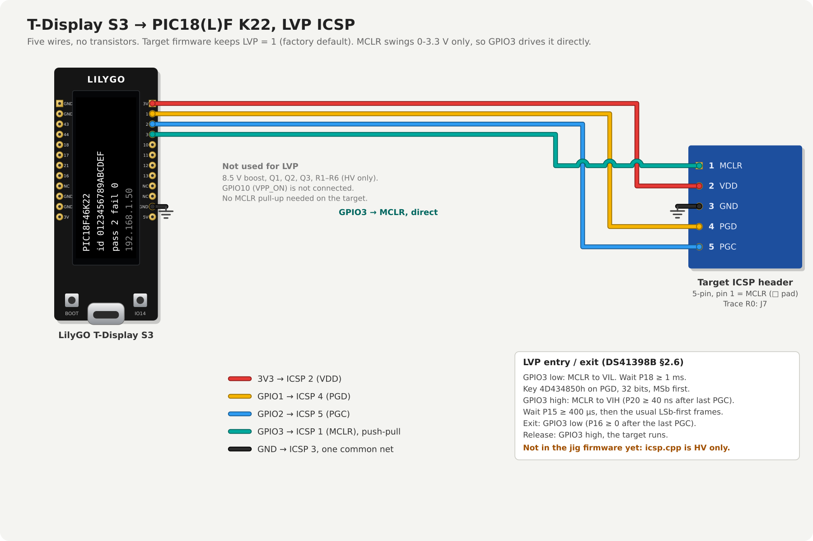

# TDisplayS3-PIC18K22-Flasher

Standalone production flasher for PIC18(L)F2xK22 / 4xK22 microcontrollers: a
LilyGO T-Display S3 (ESP32-S3) programs the target over high-voltage ICSP. No
PC, no PICkit on the line. A small text script on the jig says what to do
(save the board's EEPROM settings, erase, write the firmware, restore the
settings, verify). You load the firmware and the script to the jig over WiFi
once; after that an operator connects a board, the jig runs the script, and
the screen shows PASS or FAIL. The jig is generic: it isn't tied to one
board, and each board's EEPROM settings are kept on the jig per board, so they
survive a full reflash.

**Status: nothing has been run on hardware yet.** The firmware builds, and the
host tests pass (`make test`). The programming timing and command values were
taken from DS41398B by the implementer while writing the code; the circuit and
resistor values below are the PICkit 2 MCLR drive with values picked for this
jig. Plan a bring-up on a known board (see [Status](#status)).

Sibling projects (same screen, web page and state machine; only the wire and
device layers differ):
[TDisplayS3-STM32F1-Flasher](https://github.com/holla2040/TDisplayS3-STM32F1-Flasher) (SWD) and
[TDisplayS3-STM8S-Flasher](https://github.com/holla2040/TDisplayS3-STM8S-Flasher) (SWIM).

## What you need

| Item | Notes |
|---|---|
| LilyGO T-Display S3, LCD version (not AMOLED), 16 MB flash / 8 MB PSRAM | The build assumes 16 MB flash and OPI PSRAM. |
| Target with a PIC18(L)F K22 | Any of the 16 parts in [Supported targets](#supported-targets-and-limits), on your own board or a bare chip. 3.3 V only. |
| On-board 5 V to 8.5 V boost circuit | Makes VPP from the jig's 5 V. MT3608-class (LCSC C84817) with its inductor, Schottky diode, capacitors and feedback divider set for 8.5 V. See [Wiring](#wiring). |
| 2 x AO3400A N-channel MOSFET, 1 x AO3401A P-channel MOSFET (SOT-23) | The MCLR drive; see [Wiring](#wiring). |
| Resistors: 100 Ω, 10 kΩ, 4 x 1 kΩ | R2, R4, R1/R3/R5/R6. The 10 kΩ pull-down R4 on GPIO10 is **required**. |
| 6 wires, or a pogo-pin / clip fixture | Keep them short. |
| 5 V USB-C supply for the jig | The only supply: the jig powers the target from its 3V3 pin and the boost circuit from its 5V pin. |
| A computer with arduino-cli | Only to build the jig firmware. |

## Build the jig firmware

Tested with arduino-cli 1.3.1, esp32 core 3.3.0, TFT_eSPI 2.5.43 and
WiFiManager 2.0.17 (by tzapu). Other versions probably work; these are known good.

```
arduino-cli config add board_manager.additional_urls https://espressif.github.io/arduino-esp32/package_esp32_index.json
arduino-cli core update-index
arduino-cli core install esp32:esp32@3.3.0
arduino-cli lib install "TFT_eSPI@2.5.43" "WiFiManager@2.0.17"
```

**TFT_eSPI needs one manual edit** or the build succeeds and the screen stays
black. In `<sketchbook>/libraries/TFT_eSPI/User_Setup_Select.h` (sketchbook is
usually `~/Arduino`), comment out `#include <User_Setup.h>` and uncomment
`#include <User_Setups/Setup206_LilyGo_T_Display_S3.h>`. The edit applies to
every sketch that uses TFT_eSPI and is lost when the library is updated.

Clone into a folder named exactly `TDisplayS3-PIC18K22-Flasher` (arduino-cli
requires the folder to match the .ino name; a GitHub ZIP unpacks to `...-main`,
so rename it). Then, on Linux/macOS:

```
make bin                        # compile into /tmp/arduino-build-pic18
make usb port=/dev/ttyACM0      # upload over USB
make test                       # optional: host-side tests of the HEX parser, script runner and part table (g++)
```

On Windows, or without make, use arduino-cli directly with the same board settings:

```
arduino-cli compile -b esp32:esp32:esp32s3:CDCOnBoot=cdc,FlashSize=16M,PartitionScheme=app3M_fat9M_16MB,PSRAM=opi --output-dir build .
arduino-cli upload  -b esp32:esp32:esp32s3:CDCOnBoot=cdc,FlashSize=16M,PartitionScheme=app3M_fat9M_16MB,PSRAM=opi -p COM5 --input-dir build .
```

Arduino IDE equivalent: board "ESP32S3 Dev Module", USB CDC On Boot: Enabled,
Flash Size: 16MB, Partition Scheme: "16M Flash (3MB APP/9.9MB FATFS)", PSRAM: OPI PSRAM.

If no serial port shows up for the first USB upload: hold BOOT, tap RST,
release BOOT, then upload. After that, updates can go over WiFi
([Updating the jig](#updating-the-jig)).

## Wiring

3.3 V target, high-voltage ICSP. Besides PGC, PGD and VDD, the jig has to
switch the target's MCLR pin between ground (reset), floating, and 9 V (HV
programming mode). That takes three transistors, the same arrangement as the
PICkit 2:



| T-Display S3 | Connects to |
|---|---|
| GPIO 1 | ICSP pin 4, PGD (bidirectional) |
| GPIO 2 | ICSP pin 5, PGC (the jig drives it) |
| GPIO 3 (`MCLR_LOW`) | R1 1 kΩ to the gate of Q1 (N-channel). Q1's drain goes through R2 100 Ω to MCLR, its source to GND: it holds the target in reset. On by default. |
| GPIO 10 (`VPP_ON`) | R3 1 kΩ to the gate of Q2 (N-channel), and **R4 10 kΩ from GPIO10 to GND**. Q2's drain goes through R5 1 kΩ to the gate of Q3 (P-channel), its source to GND. |
| 3V3 | ICSP pin 2, VDD: the jig powers the target |
| 5V | Boost circuit input (its output is the VPP rail below, 8.5 V) |
| GND | ICSP pin 3, GND, the circuit's ground, and the boost circuit's ground: one common net |

Q3 is the high-side switch: source to +9 V, drain to MCLR, gate pulled up to
9 V by R6 1 kΩ and pulled down through R5 and Q2 when GPIO10 is high. R5/R6
halve the swing, so Q3 sees VGS = -4.5 V when on, inside the AO3401A's ±12 V
limit (a gate pulled straight to GND would see -9 V). MCLR (Q3's drain, R2,
and ICSP pin 1) is one net. The target header is 5-pin.
The pins are set in `config.h`.

- **The boost output must be 8.5 V.** VPP on MCLR: 7.8-9.0 V at VDD 3.3 V
  (DS41398B D110: VDD + 4.5 V minimum, 9.0 V maximum), absolute maximum 11 V.
  Q3 passes the rail straight through, so what the boost puts out is what MCLR
  gets; 8.5 V leaves margin both ways. Set it with the feedback divider (fixed
  resistors, not a trimmer). At bring-up, measure it with no load and with VPP
  on: some boost converters creep up at near-zero load, so if it's high, add a
  small bleeder (e.g. 10 kΩ) across the output. It draws a few mA from USB
  (R5/R6 take 4.5 mA while VPP is on). Never use an unregulated converter
  (B0509S and similar) or a 9 V wall adapter: with MCLR's near-zero load their
  output rises well above 9 V.
- **GPIO10 needs the hardware pull-down (R4).** The pin floats while the
  ESP32-S3 boots, before the firmware runs. Without R4, Q2's gate floats and Q2 and Q3 can turn on
  and put 9 V on MCLR. The firmware drives GPIO10 low first thing in setup.
- **GPIO3 is an ESP32-S3 strapping pin** (JTAG signal source). It is only sampled
  when the `STRAP_JTAG_SEL` eFuse is burned, which is off by default, so it
  doesn't affect boot. Until setup runs, though, Q1's gate floats through R1, so
  MCLR is undefined for about 300 ms at every jig boot. If the target must stay
  in reset through that, add an optional 100 kΩ pull-up from GPIO3 to 3V3.
- **MCLR floats for about 5 µs on every HV entry and exit.** The firmware
  turns one switch off, waits 5 µs, then turns the other on (break-before-make,
  so 9 V never meets the pull-down). R6 1 kΩ against Q3's ~650 pF input
  capacitance turns it off in about 2 µs; if it's slower, R2 limits the
  overlap current to about 90 mA (9 V / 100 Ω).
  Scope MCLR at bring-up. During the gap the target's own pull-up can lift MCLR
  slightly. PGC and PGD are held low and the target's oscillator start-up takes
  far longer than 5 µs, so this shouldn't matter, but it hasn't been tested.
- **The target needs its usual 10 kΩ MCLR pull-up to VDD.** When both switches
  are off (the target released to run), nothing on the jig drives MCLR.
- **3.3 V targets only.** The ESP32 pins aren't 5 V tolerant. For LF parts VDD
  is limited to 3.6 V; 3.3 V is fine for both F and LF.
- **The target's MCLR pin must tolerate 9 V.** Don't leave a reset button, a
  voltage supervisor or a reset-IC output directly on MCLR on the target board:
  it would see 9 V. Isolate it with a Schottky diode, as the PICkit 2 guide
  advises. The ICSP header pinout is the standard one: 1 MCLR/VPP, 2 VDD, 3 GND,
  4 PGD, 5 PGC. The K22 has no PGM pin, so boards fit 5 pins (Trace R0: J7);
  a PICkit's pin 6 hangs off the end.
- Leave the target board's own power unplugged while it's on the jig: the jig
  powers VDD from its 3V3 pin.
- Keep wires short. If connections are flaky, raise `ICSP_HALF_PERIOD` in
  `config.h` (240 CPU cycles, about 1 µs per half clock, is the default; DS41398
  allows much faster).
- No target connected reads as `no target`: PGC and PGD have internal
  pull-downs, so the device ID reads 0x0000.
- The part choices and resistor values are mine, not from a tested board: the
  PICkit 2 arrangement with MOSFETs in place of its BJTs. The AO3400A is
  specified at VGS = 2.5 V (threshold 1.45 V max), so the 3.3 V GPIOs drive it
  fully on. R1/R3 only limit the GPIO's gate-charge current. R5/R6 draw
  4.5 mA from the boost rail while VPP is on. Q1 and Q3 body diodes stay
  reverse-biased (MCLR stays between 0 and 9 V).

## Low-voltage programming (LVP)

**LVP is the programming mode for the Trace / Module Monitor boards
(PIC18F46K22).** No 8.5 V boost is built for them, and every `firmware.hex`
for them must keep `LVP` = 1. **The jig firmware doesn't do LVP yet:**
`icsp.cpp` only has the HV entry (`icsp_enter()`, MCLR to 9 V). This section
is the wiring and the protocol it will use.

LVP applies when the target keeps `LVP` = 1 (CONFIG4L 0x300006 bit 2). LVP is
on from the factory (DS41398B §5.3: "The LVP bit defaults to a '1' (enabled)
from the factory"; datasheet DS40001412G §24.9 note 2: enabled in
unprogrammed and erased devices; Table 24-1 CONFIG4L default `1000 0101`,
0x85), so a new board takes LVP with no HV step. The K22 has no PGM pin:
entry is a key sequence on PGD while MCLR is low. Once in LVP mode MCLR is
always enabled, whatever `MCLRE` says (DS41398B §2.1.1 note 2), so
`MCLRE` = 0 targets work too. A Trace R0 board read with a PICkit 5
(2026-10-13) had CONFIG4L 0x85 (`LVP` = 1) and CONFIG3H 0x3D (`MCLRE` = 0).



Five wires, no other parts:

| T-Display S3 | Target ICSP header (5-pin; Trace R0: J7) |
|---|---|
| GPIO 3 | pin 1, MCLR (driven high and low, push-pull) |
| 3V3 | pin 2, VDD |
| GND | pin 3, GND |
| GPIO 1 | pin 4, PGD |
| GPIO 2 | pin 5, PGC |

The HV parts in [Wiring](#wiring) (the boost, Q1-Q3, R1-R6) exist only
because HV puts 9 V on MCLR, which would destroy a GPIO. In LVP, MCLR only
swings between GND and VDD, so GPIO3 drives it directly, and the target
needs no MCLR pull-up (Trace R0 has none). GPIO10 (`VPP_ON`) is unused.

- A reset supervisor or button on the target's MCLR must not fight GPIO3:
  open-drain only, or isolated with a diode.
- GPIO3 is an ESP32-S3 strapping pin and floats until `setup()` runs: MCLR is
  undefined for about 300 ms at jig boot.
- The jig powers the target from its 3V3 pin. If the target is powered from
  its own supply instead, leave pin 2 unconnected, so the two never fight.
  On Trace R0, pin 2 is the 3V3D rail, the output of LDO U6 (MCP1703A):
  powering the board through pin 2 back-feeds U6 and its 12 V input rail.

### Entry and exit (DS41398B §2.6, Figures 2-14 and 2-15, §6.0 timing)

Entry, VDD already up (P13: VDD up at least 100 ns before MCLR rises):

1. MCLR at VIH, then to VIL: GPIO3 high (no minimum hold time at VIH), then
   low. PGC and PGD low and driven.
2. Wait **P18 ≥ 1 ms** from that MCLR fall to the first PGC rise.
3. Clock the 32-bit key **4D434850h** (`0100 1101 0100 0011 0100 1000 0101
   0000`) onto PGD, **MSb first** ("The Most Significant bit of the most
   significant nibble must be shifted in first"). The command frames after
   entry stay LSb first, so `write_bits()` can't send the key as it is.
4. Wait **P20 ≥ 40 ns** after the last key PGC falls, then GPIO3 high: MCLR
   back to VIH, and held there for the whole session.
5. Wait **P15 ≥ 400 µs** after MCLR rises before the first data on PGD.
   "Signals appearing on PGD before P15 has elapsed may not be interpreted as
   valid."

Everything after entry (commands, table reads and writes, the P9/P10/P11
holds) is the same as HV.

Exit: **P16 ≥ 0** after the last PGC falls, then GPIO3 low (MCLR to VIL).
Release: GPIO3 high, and the target runs its application.

- **A part with `LVP` = 0 needs one HV pass first.** `LVP` can be set or
  cleared only in HV mode (DS41398B §5.3; datasheet §24.9). A board whose
  firmware cleared it can't be entered over LVP at all; program it once on an
  HV jig (or MPLAB with a PICkit) with a `firmware.hex` that has `LVP` = 1.
- **LVP mode can't clear `LVP`**, so programming over LVP can't lock a part
  out of LVP. Keep `LVP` = 1 in `firmware.hex` anyway: a config write in LVP
  mode leaves the bit as it is, and what the config `verify` reports for an
  `LVP` = 0 HEX in that case hasn't been tested.
- `erase chip` in LVP mode needs VDD inside D111 (DS41398B §3.1.2: 2.7 V
  minimum for bulk erase); the jig's 3V3 meets it.
- HV entry keeps working on these parts: "The High-Voltage ICSP mode is always
  available, regardless of the state of the LVP bit" (DS41398B §2.1.1 note 1).

## First boot and WiFi

WiFi is only needed to load files and to watch status from a browser.
Flashing works without it.

1. On first boot the jig opens an open WiFi access point named `PIC18Flasher`
   (no password); the screen's bottom line shows `AP: PIC18Flasher`.
2. Join it from a phone or laptop. The setup page should pop up; if not, browse
   to http://192.168.4.1/. Pick your network and enter its password.
   2.4 GHz WPA2-PSK only; WPA2-Enterprise (common on factory networks) isn't supported.
3. The jig joins the network and shows its IP address on the bottom line. Its
   web page is at that IP, or `http://PIC18Flasher.local/` where mDNS works
   (often not on Windows or corporate networks: use the IP).

The jig remembers the network. If that network is out of range at power-up,
the setup AP comes back by itself. To forget it deliberately, **hold BOOT for
5 seconds** while the jig is running: the screen shows `wifi forgotten` and the
jig restarts into the setup AP. (Don't hold BOOT while powering up: that puts
the ESP32-S3 into its USB download mode instead.)

More than one jig on the same network: give each a unique name by changing
`PROJECTNAME` in `TDisplayS3-PIC18K22-Flasher.ino` (e.g. `PIC18Flasher-2`)
before building. Otherwise their hostnames and setup APs collide.

## The script

The jig runs a text script from its own flash (FFat) on each board. On first
boot it writes this default `/flash.txt` if there isn't one:

```
read   userid  userid-{id}.hex      # chip erase wipes the user ID, so save it first
read   eeprom  settings-{id}.hex
erase  chip
write  firmware.hex
verify firmware.hex                 # before the settings overwrite any EEPROM data it carries
write  settings-{id}.hex
verify settings-{id}.hex
write  userid-{id}.hex              # last: an interrupted run leaves the ID blank, so the rerun stops
verify userid-{id}.hex
reset
```

`flash.txt` runs when a board is inserted (auto mode) or when KEY is pressed
(manual mode). Any `*.txt` on the jig can also be started from the web page
(**Run**) or with `POST /run`. Edit `flash.txt` on the web page, or upload a
replacement.

One command per line. `#` starts a comment, blank lines are ignored, tokens
are separated by spaces or tabs. File names are 1-31 characters from
`A-Z a-z 0-9 . _ -`, no folders.

| Command | Effect |
|---|---|
| `read <flash\|userid\|config\|eeprom> <file>` | Read that whole region of the target and save it as Intel HEX on the jig (overwrites). |
| `erase chip` | Bulk erase: flash, user ID, config, data EEPROM and code protection. |
| `erase eeprom` | Bulk erase of the data EEPROM only. |
| `write <file>` | Program every byte the HEX file contains, each into the region its address falls in. Doesn't erase first. |
| `verify <file>` | Read back every byte the HEX file contains and compare. |
| `reset` | Leave programming mode and release MCLR so the target runs. (The jig does this at the end of every script anyway.) |

Rules:

- **`{id}`** in a file name expands to the board's 8 user-ID bytes (0x200000
  first) as 16 uppercase hex digits. It is read **once, when the script starts**,
  before any command runs, so it still works after `erase chip`. The K22 has
  no factory serial number: the user ID is the board's identity, programmed by
  your firmware build or with MPLAB. The jig doesn't assign IDs.
- If any line uses `{id}` and the board's user ID is blank (all 0xFF), the
  script stops before touching the chip: orange `blank userid`. Otherwise all
  unnumbered boards would share one settings file.
- The whole script is checked before the first command runs: a syntax error
  anywhere stops it with the line number, and every file a `write` or `verify`
  names must exist on the jig or be saved by an earlier `read` in the same
  script. A missing file never silently skips a step.
- If the script has a `read eeprom` line and the board has EEPROM read
  protection set (`CPD` = 0 in CONFIG5H), the script stops before the first
  command runs: orange `EE locked`. The erase that follows would otherwise
  destroy settings the jig couldn't save.
- `verify` compares only the bytes the file contains. For the config words it
  compares only the implemented bits (unimplemented bits read back as 0).
- `erase chip` resets the config words to their defaults. To restore them,
  `firmware.hex` has to contain them (MPLAB X and XC8 hex files do).
- `write` programs flash in 64-byte rows, so it needs erased cells: run
  `erase chip` first, or the `verify` will report what didn't take. The user ID
  (one 8-byte row) is erased automatically before it is written. EEPROM bytes erase themselves as they're written.
- Every `write` and `verify` file is also parsed against the detected part
  before the first command runs, so a HEX record outside the part's regions
  ("0x... outside chip", e.g. a 64 KB build on a 32 KB part) or a bad checksum
  stops the script before the chip is touched. Files an earlier `read` in the
  script saves are the exception: the jig makes those from the chip itself.
- A `write` to the user ID erases the user-ID block first, so the last user-ID
  write wins.
- `firmware.hex` must not carry user-ID (IDLOC) records when a later line
  writes the user ID (`userid-{id}.hex` in the default script): the script
  stops before touching the chip with `firmware has userid` at the firmware
  line. Otherwise the firmware's ID would be back on the board before the
  settings are written, and a run cut short there would be rerun as if it had
  finished the settings.
- Before the first command, and again whenever a `verify` finds a mismatch, the
  jig re-reads the device ID. ICSP has no acknowledge and a missing board reads
  as zeros, so a board that isn't there (or is a different part) is a `comm
  error`, never a FAIL.
- A script line can be at most 127 characters, comments included; a longer
  line is a `syntax` error.
- Only HEX record types 00, 01 and 04 are accepted.
- The script stops at the first error. Every stop is reported with its line
  number on screen and in the serial log.

### What the default script does to a board

1. Saves the user ID and the data EEPROM to `userid-<id>.hex` and
   `settings-<id>.hex` on the jig (the first time a board is seen this
   creates them; afterwards they are rewritten from the board each run).
2. Erases the whole chip.
3. Writes and verifies `firmware.hex`.
4. Writes and verifies the saved settings. Any EEPROM data in `firmware.hex`
   is replaced by the board's own settings here, which is why the firmware is
   verified first.
5. Writes and verifies the saved user ID, last. If the run stops anywhere
   between the erase and this step, the board's user ID is still blank, so the
   rerun stops at `blank userid` instead of saving the half-written EEPROM over
   the good `settings-<id>.hex` (see [If a run stops](#if-a-run-stops-after-erase-chip)).
6. Releases the target, which runs the new firmware.

Writing the EEPROM takes at least 4 ms per byte (256 bytes about 1 s, 1 KB about
4 s), which dominates the run time on EEPROM-heavy boards. That figure is from
the timing constants in `icsp.h`, not a measurement.

## Making the files

- **`firmware.hex`** - your application as Intel HEX, from MPLAB X / XC8 or any
  tool that writes `.hex`. Include the config words if the board needs
  non-default ones. Upload it with that exact name (or edit `flash.txt` to
  use another).
  **Don't set any code-protect or write-protect config bits** (`CP0`-`CP3`,
  `CPB`, `CPD`, `WRT0`-`WRT3`, `WRTB`, `WRTC`, `WRTD`) in it yet. The script
  writes the config words with the firmware, before its own verify and the
  settings write. Until hardware bring-up shows these bits only take effect
  after a reset, a protected firmware may fail its verify, block the settings
  write, or leave the board stuck at `EE locked` on its next reflash. And
  erasing the user-ID block (done before every user-ID write) on a
  code-protected chip erases all program memory (DS41398B §3.1.1).
- Build `firmware.hex` **without user-ID (IDLOC) records**: the default script
  writes the board's own user ID last, and stops with `firmware has userid`
  if the firmware carries one too.
- **Settings and user ID files** are made by the jig. A board with a blank user
  ID must have its ID programmed once (MPLAB with a PICkit, or a first-stage
  firmware build) before it can use the default script.
- The default script always overwrites `settings-<id>.hex` with what the board
  holds. To seed boards with EEPROM contents of your own, upload that file under
  the board's name and remove the `read eeprom` line from the script.

## Loading files onto the jig

Any of:

- The jig's web page: **Files** → choose or drop a file → **Upload**.
- `curl -F file=@firmware.hex http://<jig-ip>/file`
- `make file F=firmware.hex ip=<jig-ip>`

The file is stored under its own name, replaces any file of that name, and
survives power cycles and jig firmware updates. **Uploading never runs
anything.** A board already on the jig is not touched until the next insertion,
a KEY press (manual mode), or **Run**.

The Files list on the web page also downloads and deletes files; `GET /file?name=`
and `DELETE /file?name=` do the same. Download `settings-<id>.hex` and
`userid-<id>.hex` to inspect or archive a board's saved state.

## Production operation

### Operator steps

1. Power the jig. The home screen shows the board status, the board's user ID,
   the counters and the IP address.
2. Connect a board. Within about a second the jig detects it, shows the part
   name and user ID, then switches to the flash screen: the script name, the
   part, and the current script line.
3. Read the result bar, then disconnect the board. The result also stays on
   the home screen until the board is removed.
4. Connect the next board.

The jig runs the script on each board **once per connection**. A board left
connected is never rerun, whatever its result. To retry, disconnect it, wait
until the result clears from the home screen (about 3 s), and reconnect it.
The jig counts a board as removed after 3 probes in a row (about 3 s) find
nothing, so one bad contact can't make it reflash a board that never left. A
board swapped in faster than that is still run if its user ID differs from the
last board's (seen on two probes in a row, so it starts about 2 s after
seating). **Gap:** two boards with the same user ID (e.g. both blank) swapped
within about 3 s look like one board, and the second is not run; its home
screen still shows the first board's result. Leave the jig empty until the
result clears when that can happen.

While idle, the jig probes for a board once a second: it enters HV programming
mode, reads the device ID and the user ID, and releases the target. **A board
left on the jig is therefore reset once a second** (one HV session per probe)
and runs only between probes: don't run functional tests while it's connected.

### Screen messages

| Screen | Meaning | What to do |
|---|---|---|
| `no target` | Nothing answered (device ID read 0x0000 or 0xFFFF). | Check the connection, power, MCLR circuit and the boost output (8.5 V). |
| `PIC18F46K22` (or another part name) | Board detected. | - |
| `id 0123456789ABCDEF` | The board's user ID: what `{id}` expands to. | - |
| `id blank` | User ID is all 0xFF. | Program an ID, or the default script stops with `blank userid`. |
| `unknown 0x5200` | A device ID that isn't in the table, shown raw (revision bits included). | Not a supported part; no script runs on it. |
| green `PASS` | Every script line ran; every `verify` matched. The board was released and is running. | Good board. |
| red `FAIL` with `verify 0x000104` | A `verify` found a mismatch; the address is on the line above. | Reject. A board that FAILs twice is bad. |
| orange `comm error no verdict` | Three attempts couldn't finish (the device ID didn't match at the start of a run or after a verify mismatch, or an EEPROM write never completed). | Reconnect once. If it repeats, set it aside and check the serial log. |
| orange `no target removed` | A comm error, then the board was gone when the jig went to retry. | Reconnect it. If it stopped after `erase chip`, see [below](#if-a-run-stops-after-erase-chip). |
| orange `unknown part skipped` | The device ID isn't in the table. | Wrong part. |
| orange `blank userid` (`line N`) | A line uses `{id}` and the board's user ID is blank. Nothing was changed. | Program a user ID. |
| orange `EE locked` (`line N`) | The script reads the EEPROM and the board has EEPROM read protection. Nothing was changed. | Unprotect it, or edit the script. |
| orange `syntax` / `no firmware.hex` (`line N`) | Script error or missing file; found before the chip was touched. | Fix the script or upload the file. |
| orange `0x...... outside chip` / `bad checksum` (`line N`) | A HEX file problem, found before the chip was touched. | Fix the file (built for the wrong part?). |
| orange `firmware has userid` (`line N`) | That line's file carries user-ID records and a later line writes the user ID too. Nothing was changed. | Rebuild `firmware.hex` without IDLOC records. |
| orange `no script flash.txt` | The script isn't on the jig. | Upload one. |
| `no target, check wiring` | Manual mode: KEY pressed with nothing connected. | - |
| `AP: PIC18Flasher` / `wifi: connecting` | Not on WiFi (bottom line). | Only matters for uploads; see [WiFi](#first-boot-and-wifi). |
| `updating flasher` | Jig firmware update in progress. | Wait; it restarts. |

Messages longer than 18 characters are cut on screen; the serial log has the
full text. FAIL means one thing only: a `verify` mismatch. Script errors (the
orange notices) are never FAIL and aren't retried.

**A board that loses contact mid-run is a `comm error`, not a FAIL.** ICSP has
no acknowledge: the jig clocks commands out and reads data back, but nothing
tells it a command was lost, and a missing board reads as zeros. So whenever a
`verify` finds a mismatch, the jig re-reads the device ID first: if the board
is gone or answers as a different part, the result is a comm error. A FAIL
means the board was still there and its contents were wrong. A contact that
drops and comes back between the write and the verify can still show as FAIL.

#### If a run stops after `erase chip`

Power loss, a board pulled mid-run, a `comm error`, or a FAIL at `verify
settings` all leave the board erased or half-programmed. Because the default
script writes the user ID last, the board's user ID is still blank, and
rerunning stops at `blank userid` without touching anything: the jig's
`userid-<id>.hex` and `settings-<id>.hex` from the start of the run are kept.

To recover the board, run a one-off script that names its files explicitly.
Find the board's ID (it was on the home screen as `id ...` before the run, and
its `userid-<ID>.hex` is in the jig's file list), then upload this as, say,
`recover.txt`, with the ID filled in, and start it with **Run** on the web page:

```
erase  chip
write  firmware.hex
verify firmware.hex
write  settings-0123456789ABCDEF.hex
verify settings-0123456789ABCDEF.hex
write  userid-0123456789ABCDEF.hex
verify userid-0123456789ABCDEF.hex
reset
```

It has no `read` lines and no `{id}`, so the blank user ID doesn't stop it and
nothing on the jig is overwritten. Use it only on the board those files came
from (see [Settings are per board](#settings-are-per-board)), then delete it.
Programming the user ID back with MPLAB and rerunning `flash.txt` also works.

### Counters, buttons and mode

- `pass` and `fail` count script results since power-up, not boards: a board
  reconnected and run again counts again. They reset on power-cycle;
  record them first. `comm error` and the orange script errors count as neither.
- Auto mode (the default) runs `flash.txt` on every newly connected board. The
  mode isn't shown on the screen; the web page shows it. A short press of BOOT
  switches to manual mode, where nothing runs until KEY (GPIO14) is pressed. If
  boards are detected but never run, the jig is in manual mode: press BOOT
  once or power-cycle (it always starts in auto).
- KEY during the 1 s result display reruns the same board, in either mode.
- BOOT held 5 s forgets WiFi ([above](#first-boot-and-wifi)).

## Settings are per board

Each board's EEPROM settings live in `settings-<id>.hex` on the jig, named by
the board's own user ID. A script must only write a board's settings file
to a board with the same `{id}`: the default script guarantees that because
`{id}` is read from the board itself. If you write your own script, keep the
`settings-{id}.hex` name pattern; never hard-code another board's ID, and never
copy a settings file between boards.

## Supported targets and limits

The 16 parts the jig knows, by device ID (the ID register with its 5 revision bits masked):

| Parts | Device ID: F / LF | Program flash | Data EEPROM |
|---|---|---|---|
| PIC18(L)F23K22 | 0x5740 / 0x5760 | 8 KB | 256 B |
| PIC18(L)F43K22 | 0x5700 / 0x5720 | 8 KB | 256 B |
| PIC18(L)F24K22 | 0x5640 / 0x5660 | 16 KB | 256 B |
| PIC18(L)F44K22 | 0x5600 / 0x5620 | 16 KB | 256 B |
| PIC18(L)F25K22 | 0x5540 / 0x5560 | 32 KB | 256 B |
| PIC18(L)F45K22 | 0x5500 / 0x5520 | 32 KB | 256 B |
| PIC18(L)F26K22 | 0x5440 / 0x5460 | 64 KB | 1 KB |
| PIC18(L)F46K22 | 0x5400 / 0x5420 | 64 KB | 1 KB |

- The table is in `pic18k22.cpp`. Device IDs are from DS41398 Table 5-2 and sizes
  from the MPLAB X PIC18F-K_DFP 1.14.301 device files.
- **HV ICSP only, for now.** LVP is the mode for the Trace boards (parts
  that keep `LVP` = 1), but the jig firmware doesn't implement its entry
  yet. The wiring and protocol are documented in
  [Low-voltage programming (LVP)](#low-voltage-programming-lvp).
- **3.3 V targets only.** 5 V targets are out of scope.
- Other PIC families, a jig-assigned serial number, authentication and
  per-board logging beyond the saved settings files are out of scope.
- Regions the jig can read and write: flash, user ID (8 bytes at 0x200000),
  config (14 bytes at 0x300000, implemented bits only), data EEPROM (0xF00000).
- PASS checks what the script's `verify` lines check. The board isn't
  functionally tested.

## Updating the jig

The files on the jig and the WiFi settings survive a jig update.

- **Web page**: **Flasher firmware** → choose `TDisplayS3-PIC18K22-Flasher.ino.bin`
  from the build folder (not the `.merged.bin` or `.bootloader.bin`) → **Update flasher**.
  The page reports when the jig is back on the new firmware.
- **curl**: `curl -F firmware=@TDisplayS3-PIC18K22-Flasher.ino.bin http://<jig-ip>/update`
- **ArduinoOTA**: `make ota ip=<jig-ip>` (uses espota.py from the esp32 core; set
  `ESPOTA=` if yours lives elsewhere).
- **USB**: `make usb port=/dev/ttyACM0`.

ArduinoOTA from WSL2: espota needs the jig to connect back to the PC. Set
`networkingMode=mirrored` in `%USERPROFILE%\.wslconfig` (then `wsl --shutdown`),
allow inbound TCP 3233 in both the Windows firewall and the Hyper-V firewall
for WSL, and add `-P 3233` to the espota command. The web page method avoids all of this.

## Troubleshooting

The jig logs to USB serial at 115200 baud
(`arduino-cli monitor -p /dev/ttyACM0 -c baudrate=115200`). The wire layer
itself logs nothing: ICSP gives it nothing to report.

| Log line | Meaning |
|---|---|
| `wrote default /flash.txt` | First boot (or no script): the default script was created. |
| `detected: PIC18F46K22 0123456789ABCDEF` | Probe result changed (part name, then the user ID or `blank`). `detected: no target` when the board goes away. |
| `PASS: done` | Every script line ran. |
| `script: FAIL verify 0x000104 (line 5)` | The FAIL detail: address and script line. |
| `script: blank userid (line 1)` | An orange script error: the message and the line. Same form for `syntax`, `no <file>`, `EE locked` and the HEX errors. |
| `script: no part, comm error, retrying` | The probe saw a part, but at the start of the run nothing answered. |
| `script: comm error at line N, retrying` | The device ID didn't match (line 0: at the start; otherwise after a verify mismatch), or an EEPROM write didn't finish. |
| `flash: comm error, attempt n/3` | Retrying the whole script within one connection. |
| `flash: target gone, not retrying` | The re-probe before a retry found no board. |
| `manual: no target answered` / `run: no target answered` | KEY or **Run** with no board. |
| `uploaded <file>` | A file arrived over the web page / `/file`. |
| `mode: auto` / `mode: manual` | BOOT short press. |

`no target` with a board connected: check VDD (3V3 at ICSP pin 2), PGD/PGC
continuity, and that MCLR actually reaches the target (about 9 V on it while a
script runs). If MCLR sees 9 V while the jig is still booting, check R4.

Boards that show a part name but fail the verify: weak connections (raise
`ICSP_HALF_PERIOD`), a 3.3 V rail that sags under the board's load, or
code-protected flash/EEPROM from a previous life (`erase chip` clears code protection).

## Integration and security

- `GET /status` returns JSON, e.g.
  `{"detected":"PIC18F46K22","id":"0123456789ABCDEF","pass":12,"fail":0,"auto":true,"last":"PASS","build":"...","md5":"..."}`.
  `id` is the seated board's user ID (16 hex digits, `blank`, or empty when no
  board answers); `last` is the last result word until the board is removed;
  `md5` identifies the jig firmware. There's no per-board log or serial-number
  traceability beyond the saved files.
- `GET /files` lists the files on the jig (JSON name and size).
  `GET /file?name=X` downloads, `POST /file` (multipart upload, any
  valid name) stores, `DELETE /file?name=X` deletes.
  `POST /run?name=X.txt` runs a script on the seated board (404 if the file is
  missing, 409 if no board answers). A bad name, or one not ending in `.txt`, gets 400.
- `POST /update` replaces the jig firmware.
- **Nothing is authenticated**: the setup AP, every endpoint above and
  ArduinoOTA are open to anyone on the same network. Anyone who can reach the
  jig can read or delete the saved settings, replace `firmware.hex` or the
  script, run scripts on a seated board, or replace the jig firmware. Put jigs
  on an isolated network.

## Status

- Builds with arduino-cli; `make test` passes (HEX parser, script runner
  against a fake chip, the 16-part table).
- The ICSP timing constants and command values were checked by the implementer
  against DS41398B (the programming specification) during development; P10 is
  200 µs per the document. The user-ID bulk-erase code (0088h, Table 3-1) was
  re-checked against the PDF in review; the rest has not been re-checked.
- **Not yet run on hardware.** On a known K22 board, bring it up in this order:
  1. The probe shows the right part name and user ID.
  2. Load known EEPROM contents and a user ID with MPLAB, run `flash.txt`, and
     confirm in MPLAB that the EEPROM and user ID survived and the new firmware runs.
  3. A board with a blank user ID shows `blank userid` and is untouched.
  4. A `firmware.hex` with EEPROM data passes, and the board keeps its own
     settings and user ID.
  5. Pull a board during the settings write, reseat it: `blank userid`, and its
     `settings-<id>.hex` is unchanged.
  6. A `firmware.hex` with `CP0` = 0 and `CPD` = 0: do the bits take effect
     before the reset? Until this is known, see [Making the files](#making-the-files).
  7. Scope MCLR on HV entry and exit: no overlap, it reaches 9 V.

## Design

See [docs/architecture.md](docs/architecture.md) for how the ICSP driver, the
device layer and the script runner work, and [docs/design.md](docs/design.md)
for the original spec.

## License

MIT - see [LICENSE](LICENSE).
